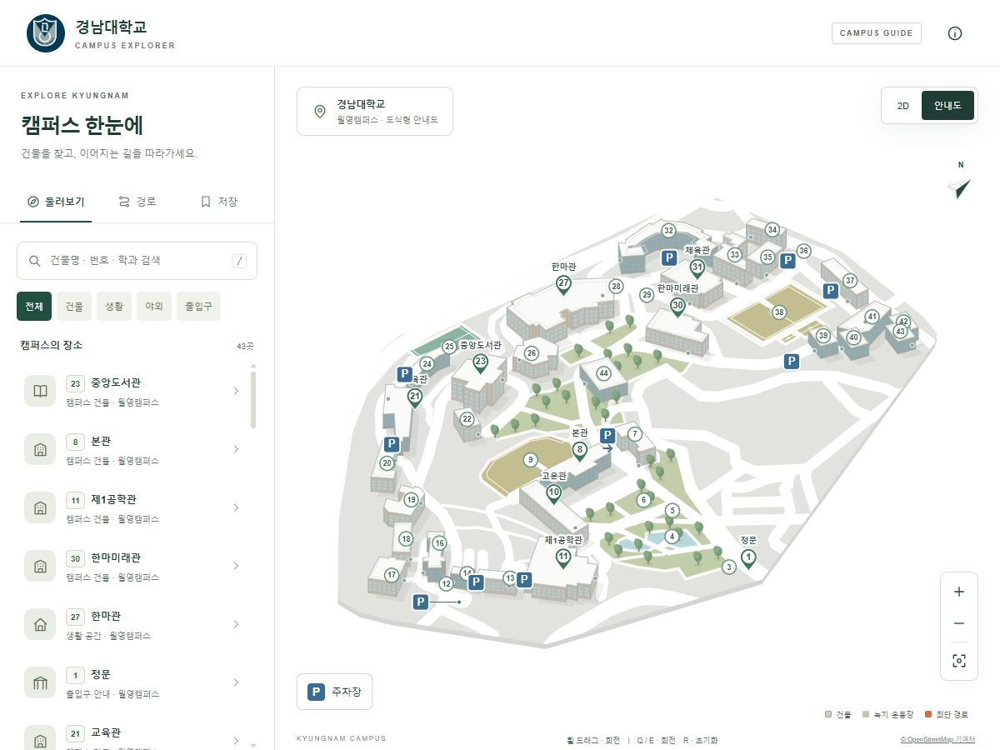
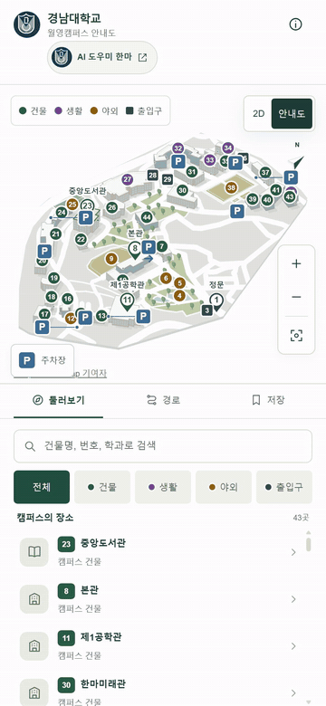
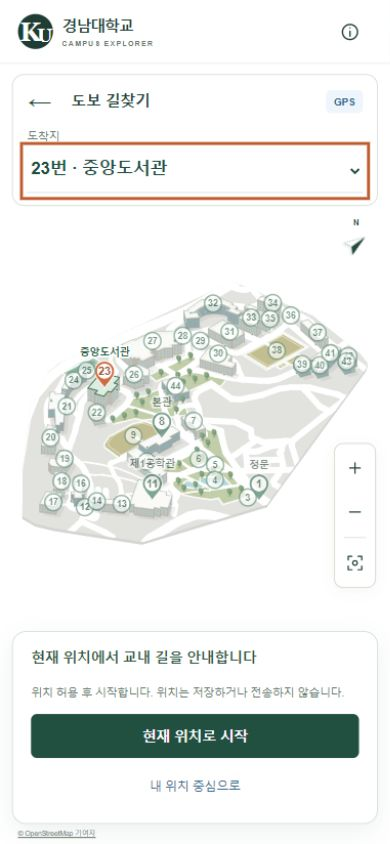
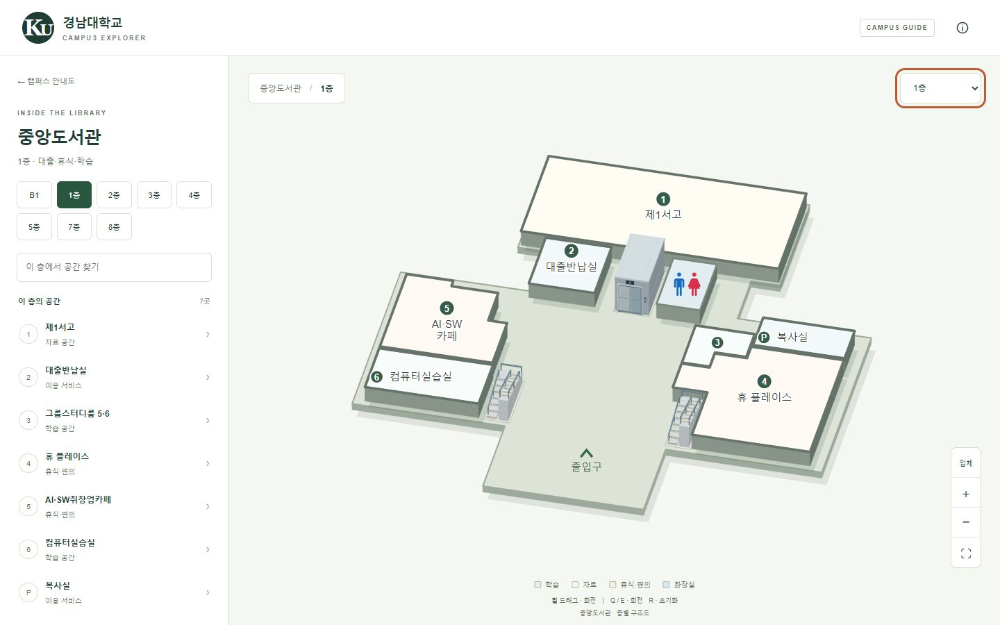
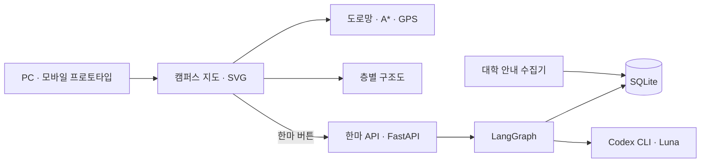

# Hanma: Kyungnam Campus Map

**경남대학교 캠퍼스 안내 · GPS 길찾기 · AI 도우미 한마**

- **팀명**: 어디로 가조
- **목표**: 캠퍼스 지도와 학교생활 안내를 연결하는 모바일 앱
- **현재 구현**: 지도·길찾기·층별 구조도 프로토타입, 한마 AI 서버
- **개발 계획**: 모바일 앱 구현, 위치 권한 연동, 교내 GPS 테스트, 앱 배포



<sub>캠퍼스 건물과 보행 도로망 · 개발 중 촬영한 PC 화면</sub>

## 길찾기 영상

<a href="docs/videos/campus-navigation.mp4"></a>

- **시연 흐름**: 출발지·목적지 선택 → 최단 경로 → 거리·예상 도보 시간
- **화면**: 모바일 프로토타입 · 장소 간 길찾기 화면 녹화
- **[전체 영상 보기 · MP4](docs/videos/campus-navigation.mp4)**

## 주요 기능

| 기능 | 내용 |
| --- | --- |
| 장소 검색 | 43개 장소 · 건물명·번호·학과·시설명 검색 |
| 건물 안내 | 건물 사진 · 층별 학과·부서·시설 확인 |
| 길찾기 | 출발지·목적지 선택 · 최단 경로·거리·예상 도보 시간 |
| GPS 안내 | 현재 위치 연결 · 이동에 따른 남은 거리·시간 갱신 |
| 층별 구조도 | 중앙도서관 8개 층 · 성훈관 1–5층 · 입체·평면 전환 |
| 실내 시설 | 방 이름 · 계단·엘리베이터 모형 · 남녀 화장실 표시 |
| 주차장 | 주차장 9곳 · 창조관 주차장 입구 |
| AI 도우미 | 학교생활 질문 · 대학 안내 자료 검색 · 답변과 출처 링크 |

<table>
  <tr><th>모바일 길찾기</th><th>AI 도우미 한마</th></tr>
  <tr>
    <td align="center"></td>
    <td align="center"></td>
  </tr>
</table>

<sub>모바일 프로토타입의 위치 권한 요청 전 화면 · 한마 질문 화면</sub>

## 기획 목적

- 건물 위치와 층별 시설 정보를 한 화면에서 탐색
- 건물명 대신 번호·학과·시설명으로 목적지 검색
- 장소 검색 → 보행 경로 → 층별 공간 → 학교생활 질문으로 연결

## 구현 방식

### 캠퍼스 지도·길찾기

- HTML·CSS·JavaScript·SVG 기반 도식형 안내도
- 건물 윤곽·높이 단순화 · 이동·확대·회전 지원
- 사용자 편집 도로망 반영: **1,532개 구간 · 43개 장소 연결점**
- 지도 표시와 길찾기에 동일한 도로 데이터 사용
- 이진 힙 기반 A*로 거리 기준 최단 경로 계산
- 도보 시간: 시속 **4.5km**, 분당 **75m** 기준 · 분 단위 올림 · 최소 1분
- 브라우저 위치 API로 위치·정확도·갱신 시각 확인
- GPS 좌표의 서버 전송·저장 없이 브라우저에서 처리
- 코드: [core.js](map/core.js) · [scene.js](map/scene.js) · [road-network.js](map/road-network.js) · [gps-navigation.js](map/gps-navigation.js)

### 층별 구조도

- 도서관 층별 도면과 제공된 성훈관 구조도의 방·복도 구획 반영
- 방 상판·옆면, 계단·엘리베이터 XYZ 모형 구성
- 회전에 따른 가림 순서 계산 · 층 선택·검색·입체·평면 전환

| 건물 | 제공 층 |
| --- | --- |
| 중앙도서관 | B1 · 1 · 2 · 3 · 4 · 5 · 7 · 8층 |
| 성훈관 | 1 · 2 · 3 · 4 · 5층 |



<sub>중앙도서관 1층 · 방 구획, 복도, 중앙 엘리베이터, 양쪽 계단, 화장실</sub>

- 코드: [library.js](map/library.js) · [seonghun-plans.js](map/seonghun-plans.js) · [floor-scene.js](map/floor-scene.js) · [amenity-models.js](map/amenity-models.js)

### AI 도우미 한마

- FastAPI: 질문 API와 테스트 화면
- LangGraph: 질문 분석 → 검색 → 답변 생성 → 출처 검증
- SQLite: 수집된 대학 안내 자료를 읽기 전용으로 검색
- Codex CLI · `gpt-6-luna`: 질문 분석과 답변 생성
- 모델 호출 실패 시 원문 검색 기반 응답으로 전환
- 코드: [graph.py](chatbot/harness/campus_bot/graph.py) · [retrieval.py](chatbot/harness/campus_bot/retrieval.py) · [codex.py](chatbot/harness/campus_bot/codex.py)

## 시스템 구성



- 지도와 한마 서버 독립 실행
- 로컬 포트: 지도 `4317` · 한마 `8765` · 선택적 공유 게이트웨이 `4318`

## 실행 방법

### 지도 프로토타입

- 필요 환경: Node.js
- 실행 위치: 저장소 루트

```bash
node map/serve.mjs
```

- [PC 지도](http://127.0.0.1:4317/index.html) · [모바일 지도](http://127.0.0.1:4317/mobile.html)
- 조작: 왼쪽 드래그 이동 · 휠 확대·축소 · 휠 버튼 드래그 회전
- 키보드: `Q`·`E` 회전 · `R` 초기화

### 한마 AI 서버

- 필요 환경: Python 3.11 이상 · 기본 AI 모드용 Codex CLI와 본인 로그인
- DB 준비: `chatbot/kyungnam.db` 배치 또는 실행 프로세스의 `CAMPUS_DB_PATH` 환경변수 지정
- DB·로그인 정보·개인 환경설정은 저장소에서 제외
- 실행 환경과 설정이 처음인 경우 PowerShell에서 아래 순서로 실행

```powershell
cd chatbot/harness
.\setup.ps1 -Dev
Copy-Item .env.example .env
.\start.ps1 -Check
.\start.ps1 -Background
```

- 기존 `.env`가 있는 경우 복사 단계 생략
- [한마 화면](http://127.0.0.1:8765/mobile) · 종료: 같은 폴더에서 `.\stop.ps1`
- 원문 검색 모드: `.env`의 `CAMPUS_LLM_MODE=off`
- 상세 안내: [챗봇 실행](chatbot/README.md) · [외부 공유](docs/SHARING.md)

## 검사 명령

- 지도 검사: 저장소 루트에서 실행

```bash
node tests/map-core.cjs
node tests/map-roads.cjs
node tests/map-gps.cjs
node tests/map-sharing.mjs
```

- 한마 검사: DB 준비 후 `chatbot/harness`에서 `.\start.ps1 -Check`, `.\verify.ps1` 실행
- 기본 검사: 모델 호출 없음 · `-Live`: 실제 모델 호출과 계정 사용량 발생

## 적용 범위

- 현재 코드: 앱 개발용 프로토타입 · 모바일 앱 구현·배포는 개발 계획
- GPS: 위치 권한 필요 · 휴대전화 외부 접속 시 HTTPS 사용 · 교내 실기기 테스트는 개발 계획
- 예상 도보 시간: 거리 기반 추정 · 경사·신호 대기·개인 보행 속도 미반영
- 실내 기능: 공간 탐색·시설 표시 · 실내 자동 길찾기·위치 추적 미포함
- AI 검색: 수집된 대학 안내 자료 · 개인 학적 기록·실시간 버스 위치·좌석 현황 미포함
- 임시 공유: PC와 터널 실행 필요 · 재시작 시 주소 변경 가능

## 저장소 구성

| 경로 | 내용 |
| --- | --- |
| `map/` | 지도·도로망·GPS·층별 구조도·사진·도면 |
| `map/public-share.mjs` | 지도·한마 연결용 공유 게이트웨이 |
| `chatbot/crawl.py`, `search.py` | 대학 자료 수집·검색 |
| `chatbot/harness/campus_bot/` | 질문 API·검색·모델 어댑터·테스트 화면 |
| `chatbot/harness/tests/`, `tests/` | 챗봇·지도 자동화 검사 |
| `docs/images/` | 프로젝트 화면 사진 |
| `docs/videos/` | 길찾기 시연 영상 |
| `SOURCE_MANIFEST.json` | 가져온 코드·자산의 SHA-256 목록 |

## 팀 · 어디로 가조

| 이름 | 역할 |
| --- | --- |
| [PPigical · 김민재](https://github.com/PPigicgi) | 백엔드·프론트엔드 개발 |
| [hyeonmn · 박현민](https://github.com/hyeonmn) | QA · 서비스 테스트·피드백 |

## 기술·자료

- **지도**: JavaScript · SVG · CSS · Node.js
- **한마**: Python · FastAPI · LangGraph · SQLite · Codex CLI · `gpt-6-luna`
- **캠퍼스 정보·사진**: [경남대학교 캠퍼스투어](https://www.kyungnam.ac.kr/ko/8013/subview.do)
- **도서관 구조도**: [중앙도서관 층별 안내](https://library.kyungnam.ac.kr/webcontent/info/48)
- **건물 윤곽·도로 자료**: [OpenStreetMap 기여자](https://www.openstreetmap.org/copyright)
- **성훈관 구조도**: 제공된 1–5층 통합 구조도
- **자료 고지**: [자산·권리](docs/ASSETS.md) · [소스 구성·제외 파일](docs/EXPORT.md)
