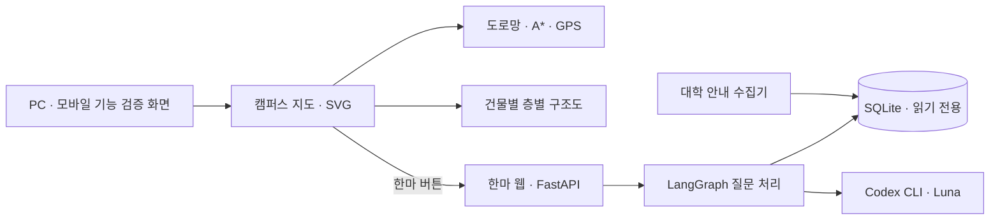

# Hanma: Kyungnam Campus Map

**캠퍼스에서 길을 찾고, 학교생활은 한마에게 묻습니다.**

경남대학교의 건물과 보행 경로, 층별 공간, 학교생활 안내를 연결하는 **모바일 앱을 만들기 위한 프로젝트**입니다. 건물 이름을 몰라도 번호나 학과·시설명으로 찾고, 목적지까지의 거리와 예상 도보 시간을 확인하며, 학교생활 질문은 AI 도우미 **한마**에게 묻는 경험을 목표로 합니다.

**어디로 가조** 팀이 개발하고 테스트하고 있으며, 최종 서비스는 **모바일 앱으로 구현할 예정**입니다. 현재 저장소에는 앱 개발에 앞서 지도·GPS 길찾기·층별 구조도·AI 연결을 확인하는 프로토타입과 한마 AI 서버, 자료 수집 코드가 들어 있습니다. 설치형 모바일 앱과 스토어 배포는 앞으로 진행할 단계입니다.


<sub>캠퍼스 건물과 연결된 길을 보여 주는 PC 지도. 아래 사진들은 개발 과정에서 촬영한 실제 화면으로, 촬영 시점에 따라 헤더와 일부 버튼 모양이 현재 코드와 다를 수 있습니다.</sub>

## 무엇을 하나

- **장소 찾기** — 43개 장소를 건물명·건물 번호·학과·시설명으로 검색하고, 건물 사진과 층별 시설을 확인합니다.
- **길찾기** — 출발지와 목적지를 고르면 연결된 보행 도로망에서 최단 경로, 거리와 예상 시간을 표시합니다.
- **모바일 GPS 안내** — 위치 권한을 허용하면 현재 위치를 도로망에 연결하고 이동에 따라 남은 거리와 시간을 갱신합니다.
- **층별 구조도** — 중앙도서관 8개 층과 성훈관 1–5층을 입체 또는 평면으로 살펴봅니다. 방 이름, 계단, 엘리베이터와 화장실 표시를 함께 제공합니다.
- **주차장 위치** — 주차장 9곳과 창조관 주차장 입구를 지도에 표시합니다.
- **학교생활 질문** — 한마가 질문을 분석하고 수집 자료에서 근거를 찾아 답변과 출처 링크를 제공합니다.

<table>
  <tr><th>모바일 길찾기</th><th>AI 도우미 한마</th></tr>
  <tr>
    <td align="center"></td>
    <td align="center"></td>
  </tr>
</table>

<sub>왼쪽은 앱 구현에 앞서 기능을 확인하는 모바일 프로토타입입니다. 위치 권한 요청 전 화면이며, GPS 이동을 모의로 재현한 결과 사진은 아닙니다.</sub>

## 왜 만들었나

처음 방문한 캠퍼스에서는 건물 위치를 알아도 그 안의 학과나 시설이 몇 층에 있는지 다시 찾아봐야 합니다. 길을 찾다가 학교생활 안내가 필요하면 대학 홈페이지의 다른 페이지로 이동해야 합니다.

이 프로젝트는 그 과정을 이어 주는 데서 시작했습니다. **장소를 검색하고 → 연결된 길을 확인하고 → 건물 안의 층을 살펴보고 → 필요한 안내를 질문하는 흐름**을 하나의 모바일 앱에서 제공하려고 합니다. 현재는 이 흐름을 프로토타입으로 구현해 PC와 휴대전화 화면에서 테스트하고 있습니다.

## 앱 구현 계획

프로토타입에서 확인한 캠퍼스 지도, GPS 길찾기, 층별 구조도와 한마 질문 기능을 모바일 앱으로 이어갈 예정입니다. 앱 환경에 맞는 화면과 위치 권한 흐름을 적용하고, 실제 캠퍼스에서 GPS 안내와 사용성을 점검한 뒤 배포를 준비합니다. 대상 운영체제와 앱 프레임워크는 추후 정합니다.

## 어떻게 만들었나

### 1. 건물의 세부 묘사보다 길의 연결을 먼저 정했습니다

지도는 HTML·CSS·JavaScript와 SVG로 그립니다. 건물 윤곽과 높이를 단순화해 안내도처럼 표현하고, 사용자가 직접 수정한 도로망을 기본 데이터로 반영했습니다. 별도의 지도 SDK나 프론트엔드 빌드 과정 없이 실행됩니다.

도로는 교차점에서 구간을 나누고 가까운 연결점을 맞춰 그래프로 구성합니다. 지도에 보이는 길과 길찾기에 사용하는 길은 같은 데이터를 읽습니다. 최종 기본 도로망은 1,532개 구간과 43개 장소 연결점을 포함합니다.

- 지도와 투영: [`scene.js`](map/scene.js), [`core.js`](map/core.js)
- 도로 연결과 분할: [`road-network.js`](map/road-network.js)
- 기본 도로망: [`final-roads.js`](map/final-roads.js)

### 2. 경로와 시간은 같은 거리에서 계산합니다

이진 힙을 사용하는 A*로 거리 기준 최단 경로를 계산합니다. 예상 도보 시간은 경로 길이를 분당 75m, 즉 시속 4.5km로 나눈 뒤 분 단위로 올립니다. 최소 표시 시간은 1분입니다.

GPS는 브라우저의 위치 API를 사용합니다. 위치 정확도와 갱신 시각을 확인하고, 수신 위치가 교내 도로에서 너무 멀면 경로로 연결하지 않습니다. 지도 코드가 GPS 좌표를 저장하거나 서버로 보내지는 않습니다.

관련 코드: [`gps-navigation.js`](map/gps-navigation.js), [`app.js`](map/app.js).

### 3. 층별 도형을 입체 공간으로 바꿨습니다

중앙도서관의 층별 도면과 제공받은 성훈관 구조도에서 방과 복도의 구획을 가져왔습니다. 방에는 상판과 옆면을, 계단과 엘리베이터에는 XYZ 좌표로 만든 모형을 적용했습니다. 회전할 때 공간과 시설이 가려지는 순서도 계산합니다.


<sub>중앙도서관 1층. 방 구획과 낮은 복도, 중앙 엘리베이터, 양쪽 계단, 남녀 화장실 표시를 볼 수 있습니다.</sub>

| 건물 | 구조도를 제공하는 층 |
| --- | --- |
| 중앙도서관 | B1 · 1 · 2 · 3 · 4 · 5 · 7 · 8층 |
| 성훈관 | 1 · 2 · 3 · 4 · 5층 |

관련 코드: [`library.js`](map/library.js), [`seonghun-plans.js`](map/seonghun-plans.js), [`floor-scene.js`](map/floor-scene.js), [`amenity-models.js`](map/amenity-models.js).

### 4. 한마는 질문을 정리한 뒤 자료를 검색합니다


FastAPI가 웹과 API를 제공하고 LangGraph가 질문 처리 단계를 연결합니다. 기본 설정은 로그인된 Codex CLI로 `gpt-6-luna`를 호출하는 방식입니다. 분석과 답변은 하나의 전체 처리 시간 한도를 나눠 사용합니다. 모델 호출에 실패하면 원문 검색 기반 응답으로 전환했다는 상태를 반환합니다.

검색 대상은 수집된 대학 안내 자료입니다. 개인 성적·학적 기록이나 실시간 버스 위치·좌석 현황을 조회하는 서비스는 아닙니다. 모델 호출 어댑터는 읽기 전용 실행과 도구 사용 제한을 적용하며, 저장소에 로그인 정보를 포함하지 않습니다.

관련 코드: [`graph.py`](chatbot/harness/campus_bot/graph.py), [`retrieval.py`](chatbot/harness/campus_bot/retrieval.py), [`codex.py`](chatbot/harness/campus_bot/codex.py).

## 현재 프로토타입 구성



지도는 한마 서버가 꺼져 있어도 실행됩니다. 로컬에서는 지도 `4317`, 한마 `8765` 포트를 사용합니다. 선택적으로 공유 게이트웨이 `4318`을 실행하면 지도와 한마 화면을 같은 주소에서 연결합니다.

## 프로토타입 직접 실행하기

### 지도

Node.js가 설치된 환경에서 저장소 루트 기준으로 실행합니다.

```bash
node map/serve.mjs
```

- PC 지도: [http://127.0.0.1:4317/index.html](http://127.0.0.1:4317/index.html)
- 모바일 지도: [http://127.0.0.1:4317/mobile.html](http://127.0.0.1:4317/mobile.html)

지도만 실행할 때는 패키지 설치, DB와 API 키가 필요 없습니다. 마우스 왼쪽 드래그는 이동, 휠은 확대·축소, 휠 버튼 드래그는 회전입니다. 키보드 `Q`·`E`는 회전, `R`은 초기화입니다.

### 한마 AI 서버

Python 3.11 이상이 필요하며 기존 환경은 Python 3.12를 사용했습니다. 수집 DB는 Git에 넣지 않았습니다. 먼저 기존 `kyungnam.db`를 `chatbot/kyungnam.db`에 두거나, 실행 프로세스의 `CAMPUS_DB_PATH` 환경변수로 DB 경로를 지정합니다.

PowerShell에서 다음 순서로 실행합니다.

```powershell
cd chatbot/harness
.\setup.ps1 -Dev
Copy-Item .env.example .env
# 기본 AI 모드에는 이 PC에서 사용 가능한 Codex CLI와 본인의 로그인이 필요합니다.
.\start.ps1 -Check
.\start.ps1 -Background
```

한마 화면은 [http://127.0.0.1:8765/mobile](http://127.0.0.1:8765/mobile)입니다. 종료는 같은 폴더에서 `.\stop.ps1`을 실행합니다. AI 없이 원문 검색만 확인하려면 `.env`의 `CAMPUS_LLM_MODE`를 `off`로 설정합니다.

DB 준비, 수집 범위와 API 설정은 [챗봇 실행 안내](chatbot/README.md), 외부 접속은 [공유 안내](docs/SHARING.md)를 참고하세요.

## 저장소 구성

| 경로 | 내용 |
| --- | --- |
| `map/` | PC·모바일 지도, 도로망, GPS, 층별 구조도, 사진·도면 자산 |
| `map/public-share.mjs` | 지도 정적 파일과 한마 API를 연결하는 선택적 게이트웨이 |
| `chatbot/crawl.py`, `search.py` | 대학 자료 수집과 기존 검색 모듈 |
| `chatbot/harness/campus_bot/` | 한마 API, 질문 흐름, 검색, 모델 어댑터, 웹 화면 |
| `chatbot/harness/tests/` | 챗봇 자동화 테스트 |
| `tests/` | 지도 경로·도로망·GPS·공유 게이트웨이 검사 |
| `docs/images/` | README에 사용한 실제 화면 사진 |
| `SOURCE_MANIFEST.json` | 가져온 코드·자산의 SHA-256 목록 |

## 확인 방법과 현재 범위

지도 검사는 저장소 루트에서 실행합니다.

```bash
node tests/map-core.cjs
node tests/map-roads.cjs
node tests/map-gps.cjs
node tests/map-sharing.mjs
```

한마는 DB와 실행 환경을 준비한 뒤 `chatbot/harness`에서 `.\start.ps1 -Check`, `.\verify.ps1`로 확인합니다. 기본 검사는 모델을 호출하지 않습니다. `-Live`는 실제 모델 사용량이 발생하는 별도 검사입니다.

- 모바일 위치 API와 이동에 따른 경로 갱신은 구현되어 있습니다. 실제 휴대전화의 교내 GPS 수신 품질과 안내 정확도는 현장 확인이 남아 있습니다.
- 예상 시간은 거리와 일정한 보행 속도로 계산합니다. 경사, 신호 대기, 공사와 개인 보행 속도는 반영하지 않습니다.
- 실내 공간 탐색을 제공하며, 실내 자동 길찾기와 실내 위치 추적은 포함하지 않습니다.
- 모바일 앱 구현과 배포는 예정 단계입니다. 현재 프로토타입의 공유 방식은 PC에서 실행하는 임시 터널입니다.

## 팀 · 어디로 가조

| 이름 | 역할 |
| --- | --- |
| [PPigical · 김민재](https://github.com/PPigicgi) | 백엔드·프론트엔드 개발 |
| [hyeonmn](https://github.com/hyeonmn) | QA · 구현된 서비스 테스트 및 피드백 |

추가 QA 참여자도 서비스 테스트와 피드백에 참여했습니다. 이름과 GitHub 계정은 확인 후 추가합니다.

## 자료와 도구

- **지도**: JavaScript, SVG, CSS, Node.js
- **한마**: Python, FastAPI, LangGraph, SQLite, Codex CLI, `gpt-6-luna`
- **캠퍼스 정보·사진**: [경남대학교 캠퍼스투어](https://www.kyungnam.ac.kr/ko/8013/subview.do)
- **도서관 구조도**: [경남대학교 중앙도서관 층별 안내](https://library.kyungnam.ac.kr/webcontent/info/48)
- **건물 윤곽·도로 자료**: [OpenStreetMap 기여자](https://www.openstreetmap.org/copyright)
- **성훈관 구조도**: 프로젝트에 제공된 1–5층 통합 구조도

자료별 권리와 가져온 범위는 [자료 고지](docs/ASSETS.md), 저장소에서 제외한 파일은 [소스 구성 안내](docs/EXPORT.md)에 정리했습니다.
